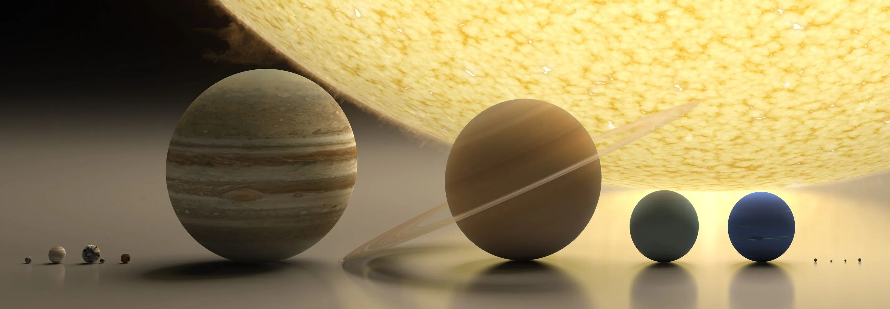
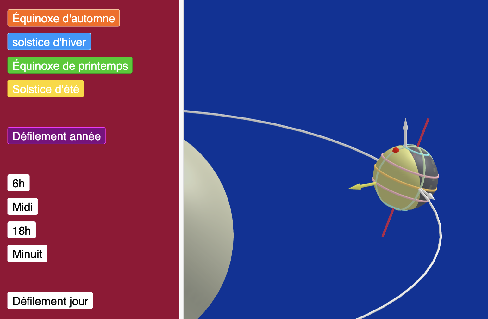

+++
title = "Le Soleil"
date = 2021-03-06T14:20:50+01:00
weight = 2
chapter = false
page_css = "css/soleil-accueil.css"
+++

<!--
  Page d'accueil du chapitre « Le Soleil », sur le modèle de la présentation (presentationssite.github.io/1es/soleil).
  Style : static/css/soleil-accueil.css, chargé uniquement sur cette page (paramètre page_css) et
  limité aux éléments situés sous le conteneur .sol-accueil.
-->

<svg width="0" height="0" style="position:absolute" aria-hidden="true">
<filter id="sol-o1" x="-10%" y="-10%" width="120%" height="120%" color-interpolation-filters="sRGB"><feMorphology in="SourceAlpha" operator="dilate" radius="1.3" result="d"/><feMorphology in="SourceAlpha" operator="erode" radius="1.3" result="e"/><feComposite in="d" in2="e" operator="out" result="ring"/><feFlood flood-color="#ffb938"/><feComposite in2="ring" operator="in"/></filter>
<filter id="sol-o2" x="-10%" y="-10%" width="120%" height="120%" color-interpolation-filters="sRGB"><feMorphology in="SourceAlpha" operator="dilate" radius="1.3" result="d"/><feMorphology in="SourceAlpha" operator="erode" radius="1.3" result="e"/><feComposite in="d" in2="e" operator="out" result="ring"/><feFlood flood-color="#5cc8ff"/><feComposite in2="ring" operator="in"/></filter>
<filter id="sol-o3" x="-10%" y="-10%" width="120%" height="120%" color-interpolation-filters="sRGB"><feMorphology in="SourceAlpha" operator="dilate" radius="1.3" result="d"/><feMorphology in="SourceAlpha" operator="erode" radius="1.3" result="e"/><feComposite in="d" in2="e" operator="out" result="ring"/><feFlood flood-color="#b69cff"/><feComposite in2="ring" operator="in"/></filter>
</svg>

<header class="sol-hero">

<h1>Le Soleil, notre source d'énergie</h1>

Rayonnement, couleur des étoiles et bilan radiatif de la Terre

<nav class="sol-actions">
<a class="sol-btn sol-btn-main" href="https://presentationssite.github.io/1es/soleil"><i class="fas fa-play"></i> Présentation<small>animations interactives et QCM</small></a>
<a class="sol-btn" href="/recapsoleil.pdf"><i class="fas fa-file-pdf"></i> Récap</a>
</nav>
</header>

<figure class="sol-photo">

</figure>

<section class="sol-part sol-p1">
<h2>01Rayonnement solaire</h2>



</section>

<section class="sol-part sol-p2">
<h2>02Bilan radiatif terrestre</h2>

<video controls>
  <source src="/inclinaison.mp4" type="video/mp4">
</video>

<i class="fas fa-globe-europe"></i> <a href="https://www.geogebra.org/m/ezzzm95w">Applet Geogebra</a> pour visualiser l'origine géométrique des lignes imaginaires que sont les tropiques et cercles polaires en lien avec les solstices et les équinoxes&nbsp;:

<i class="fas fa-video"></i> Vidéo filmée à Pune, en Inde, le 13 Mai 2023 (source&nbsp;: <a href="https://x.com/i/status/1657420559335182336">संकेत</a>) + <a href="https://alokm.com/zsd.html">tracking du zéro shadow day</a> + <a href="https://www.skymarvels.com/infopages/vids/Earth%20-%20Sub-solar%20Point%20001.htm">tracking du point subsolaire</a>&nbsp;:

<video width="800" controls>
  <source src="/noshadow.mp4" type="video/mp4">
</video>

</section>

<section class="sol-part sol-p3">
<h2>03Documents</h2>
<ul class="sol-docs">
<li><a href="/act-temp-etoile.pdf"><i class="fas fa-file-pdf"></i>Activité température et couleur des étoiles</a></li>
<li><a href="/act-dist-temp.pdf"><i class="fas fa-file-pdf"></i>Activité température et distance au Soleil</a></li>
<li><a href="/act-hauteur.pdf"><i class="fas fa-file-pdf"></i>Activité latitude et "hauteur" du Soleil</a></li>
<li><a href="/act-albedo.pdf"><i class="fas fa-file-pdf"></i>Activité température et albédo</a></li>
<li><a href="/act-bilanrad.pdf"><i class="fas fa-file-pdf"></i>Activité bilan radiatif</a><a class="sol-corr" href="/act-bilanrad-corr.pdf"><i class="fas fa-check-circle"></i> correction</a></li>
<!-- <li><a href="/correcevalsol.pdf">Correction DS</a></li> -->
</ul>
</section>

